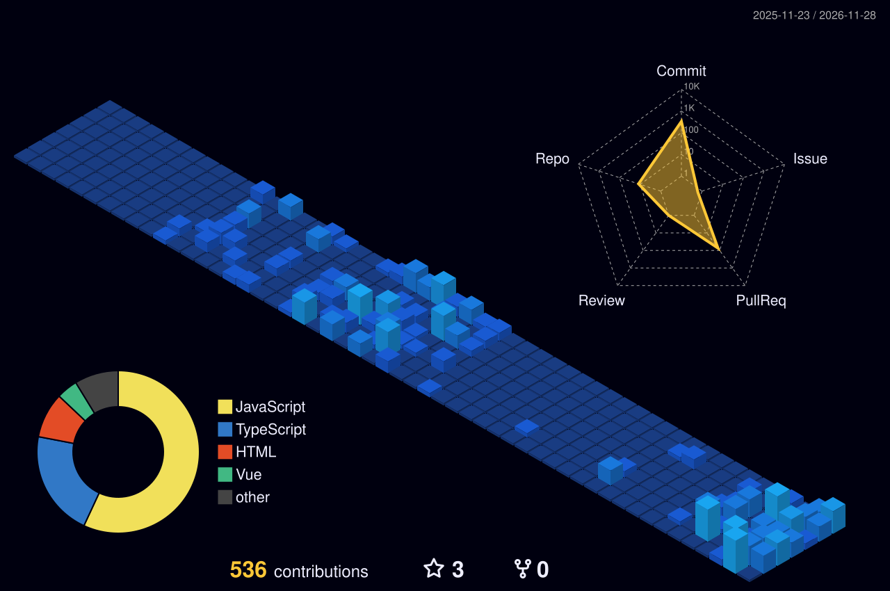

## Hey, I’m Jo 👋

**IT student • Frontend dev • UI/UX**

She’s cooking up things for the web. ✨

### Tech stack

`HTML` · `CSS` · `JavaScript` · `React` · `Vue` · `Tailwind` · `Git` · `Figma`

### GitHub activity

  

  <picture>
    <source media="(prefers-color-scheme: dark)" srcset="https://raw.githubusercontent.com/JC-glitchsys/JC-glitchsys/output/github-snake-dark.svg" />
    <source media="(prefers-color-scheme: light)" srcset="https://raw.githubusercontent.com/JC-glitchsys/JC-glitchsys/output/github-snake.svg" />
    
  </picture>

### My GitHub Pet

